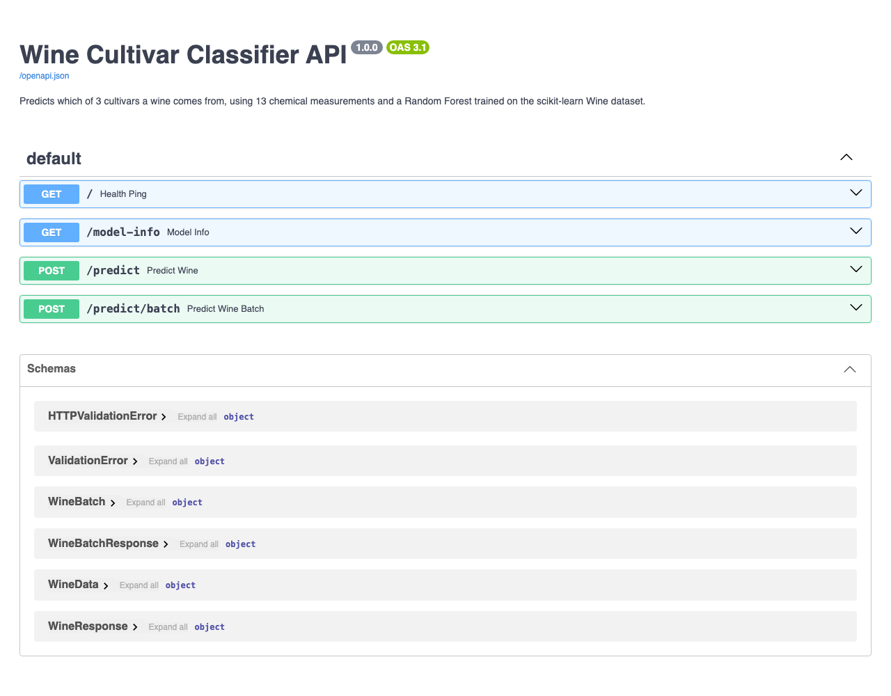

# FastAPI Lab: Wine Cultivar Classifier API

[](https://github.com/isakshay007/MLOps/actions/workflows/fastapi_lab_wine_tests.yml)

Based on the [FastAPI Lab from raminmohammadi/MLOps](https://github.com/raminmohammadi/MLOps/tree/main/Labs/API_Labs/FastAPI_Labs) ([video](https://www.youtube.com/watch?v=KReburHqRIQ&list=PLcS4TrUUc53LeKBIyXAaERFKBJ3dvc9GZ&index=4), [blog](https://www.mlwithramin.com/blog/fastapi-lab1)).

The original lab trains a Decision Tree on the Iris dataset and serves it with FastAPI and uvicorn. This version keeps the same structure (`data.py`, `train.py`, `predict.py`, `main.py`) but serves a **Random Forest trained on the Wine dataset**. It also fixes the gaps in the original: unused test set, bare-number output, no input checks and no tests.

---

## My modifications

| Area | Original lab | This version |
|---|---|---|
| **Dataset** | Iris (150 rows, 4 features, 3 flower species) | **Wine** (178 rows, 13 chemical measurements, 3 cultivars), stratified 70/30 split |
| **Model** | `DecisionTreeClassifier(max_depth=3)` | **`RandomForestClassifier(n_estimators=200, max_depth=5)`** |
| **Evaluation** | Test set created but never used | Accuracy, macro F1, confusion matrix, per-class report, 5-fold CV and top features saved to `model/metrics.json` |
| **`/predict` response** | `{"response": 0}` | Class id, **class name**, **confidence** and **probability of each class** |
| **Endpoints** | `GET /`, `POST /predict` | Adds **`GET /model-info`** and **`POST /predict/batch`** (1–100 samples) |
| **Input validation** | Types only; negative values accepted | Every field must be `> 0` with an upper limit, so negatives and typos (e.g. `1400` for `14.0`) return **422** with the field name |
| **Error handling** | All errors return 500 | Missing model returns **503** with a "run train.py" message; other failures return 500 |
| **Model loading** | Reloaded from disk on every request | Loaded once and cached |
| **File paths** | `../model/...` only works when run from `src/` | Paths built from the file's own location, so the lab runs from any folder |
| **Tests** | None | **13 pytest tests** using FastAPI's `TestClient` (one real sample per cultivar, batch, 4 validation cases, metrics) |
| **CI** | None for this lab | GitHub Actions: trains the model and runs the tests on Python 3.10–3.12 |
| **README** | Run command says `uvicorn app:main` (wrong) | Fixed to `uvicorn main:app` |

---

## Folder structure

```
FastAPI_Labs/
├── assets/docs.png          # Screenshot of the new /docs page
├── model/
│   ├── wine_model.pkl       # Trained Random Forest (replaces iris_model.pkl)
│   └── metrics.json         # Test-set metrics written by train.py (new)
├── src/
│   ├── data.py              # Loads Wine, stratified split, feature/class names
│   ├── train.py             # Trains, evaluates, saves model + metrics
│   ├── predict.py           # Cached model loading, class + probabilities
│   └── main.py              # FastAPI app: 4 endpoints, validated schemas
├── tests/
│   ├── conftest.py
│   └── test_api.py          # 13 API tests (new)
├── requirements.txt         # + pytest
└── README.md
```

The workflow is at the repository root in [`.github/workflows/fastapi_lab_wine_tests.yml`](../../../.github/workflows/fastapi_lab_wine_tests.yml), because GitHub only runs workflows from there.

---

## Running the lab

```bash
git clone https://github.com/isakshay007/MLOps.git
cd MLOps/Labs/API_Labs/FastAPI_Labs
python3 -m venv fastapi_lab_env
source fastapi_lab_env/bin/activate
pip install -r requirements.txt

cd src
python train.py                 # trains the model, writes model/metrics.json
uvicorn main:app --reload       # serves the API on http://127.0.0.1:8000
```

Open **http://127.0.0.1:8000/docs** to try every endpoint (each one has a pre-filled example):



Run the tests from the lab folder (`cd ..` if you are still in `src/`):

```bash
pytest -v tests
```

---

## Endpoints

| Method | Path | What it does |
|---|---|---|
| GET | `/` | Health check, plus whether the model file exists |
| GET | `/model-info` | Model type, 13 feature names, 3 class names and the saved test metrics |
| POST | `/predict` | Predicts one wine sample |
| POST | `/predict/batch` | Predicts 1–100 samples in one request: `{"samples": [ ... ]}` |

**Request** to `POST /predict` (a real sample from the dataset):

```json
{
  "alcohol": 14.23, "malic_acid": 1.71, "ash": 2.43, "alcalinity_of_ash": 15.6,
  "magnesium": 127, "total_phenols": 2.8, "flavanoids": 3.06,
  "nonflavanoid_phenols": 0.28, "proanthocyanins": 2.29, "color_intensity": 5.64,
  "hue": 1.04, "od280_od315_of_diluted_wines": 3.92, "proline": 1065
}
```

**Response:**

```json
{
  "class_id": 0,
  "class_name": "cultivar_1",
  "confidence": 0.9947,
  "probabilities": {"cultivar_1": 0.9947, "cultivar_2": 0.0053, "cultivar_3": 0.0}
}
```

**Invalid input** (`"alcohol": -5`) returns `422`:

```json
{"detail": [{"type": "greater_than", "loc": ["body", "alcohol"], "msg": "Input should be greater than 0", "input": -5, "ctx": {"gt": 0.0}}]}
```

---

## Results

From `model/metrics.json`, on the 54-sample held-out test set:

| Metric | Value |
|---|---|
| Test accuracy | 1.00 |
| Macro F1 | 1.00 |
| 5-fold CV accuracy (training set) | 0.975 ± 0.033 |
| Confusion matrix | `[[18,0,0],[0,21,0],[0,0,15]]` |
| Top features | color_intensity, flavanoids, proline |

The Wine classes separate well, so a perfect score on 54 test rows is expected. The cross-validation score is included as a more conservative estimate.
