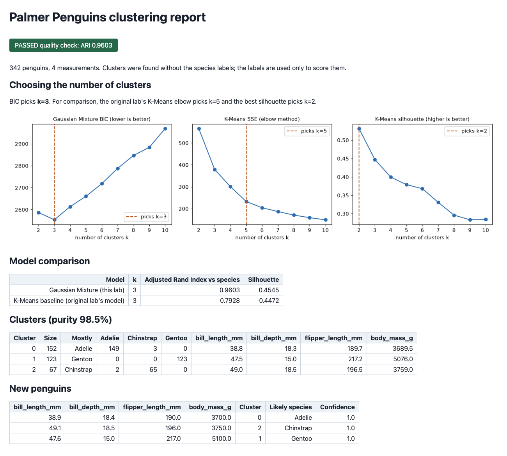
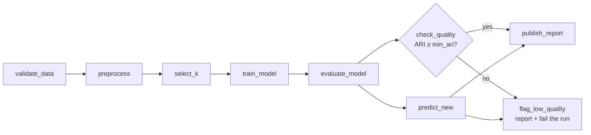

# Airflow Lab 1: Penguin Clustering Pipeline

[](https://github.com/isakshay007/MLOps/actions/workflows/airflow_lab1_penguins.yml)

Based on [Airflow Lab 1 from raminmohammadi/MLOps](https://github.com/raminmohammadi/MLOps/tree/main/Labs/Airflow_Labs/Lab_1).

An Apache Airflow 3 pipeline that groups the **Palmer Penguins** into clusters by their body measurements, without being told the species. It checks the data and picks the number of clusters. Then it trains a **Gaussian Mixture model**, scores the clusters against the real species, and labels new penguins. Each run ends by publishing an HTML report, or failing on purpose when the clusters aren't good enough.



---

## My modifications

| Area | Original lab | This version |
|---|---|---|
| **Dataset** | Credit-card customers (`file.csv`, 8,950 rows; 3 of its 18 columns used) | **Palmer Penguins** (`penguins.csv`, 344 penguins from 3 species and 3 islands, 4 body measurements, with missing values to clean) |
| **Model** | K-Means | **Gaussian Mixture** in a `StandardScaler` → `GaussianMixture` pipeline. K-Means is kept as a baseline for comparison |
| **Choosing k** | Elbow method on K-Means for k = 1–49 (49 fits) | **BIC** of the Gaussian Mixture for k = 2–10, adjustable when you trigger the run. The report shows what the elbow and silhouette would have picked |
| **Bug: saved model** | Saved the **last** model fitted (k = 49), not the one the elbow chose | Saves the model with the chosen k |
| **Bug: prediction** | Trained on min-max-scaled data but predicted on **raw, unscaled** `test.csv` | The scaler is part of the saved pipeline, so raw measurements are scaled the same way |
| **Evaluation** | Printed the elbow k only | **Adjusted Rand Index** and silhouette vs the real species (never used for fitting), purity, a cluster × species table, cluster profiles, and the same scores for the K-Means baseline → `metrics.json` |
| **Predictions** | Cluster number for 1 customer | Cluster, **likely species** and **confidence** (`predict_proba`) for 3 new penguins → `predictions.json` |
| **Dashboard** | None | **`report.html`** per run: model-selection charts, model comparison, clusters, predictions and a pass/fail banner (screenshot above) |
| **DAG** | 4 tasks in a straight line (`PythonOperator`) | **9 tasks** with the TaskFlow API (`@dag`/`@task`): a **data-quality gate** (columns, row count, missing values, valid ranges), **branching** (`@task.branch`) on a quality threshold, **run parameters** (`k_min`, `k_max`, `min_ari`), retries (except on bad data), tags and docs shown in the UI |
| **Passing data between tasks** | DataFrames pickled + base64-encoded through XCom | Each run writes files to `output/<run_id>/`; tasks pass **file paths and small JSON dicts** only |
| **Airflow setup** | No `docker-compose.yaml` in the folder; download it yourself, packages installed on every container start | **`docker-compose.yaml` included**: Airflow **3.3.2**, **LocalExecutor** (no Redis/Celery, fits in 4 GB), examples off, a **custom image** (`Dockerfile`) with pinned packages, `output/` mounted |
| **`setup.sh`** | Deleted the committed `config/` folder on every run | Keeps `config/`, creates `output/`, builds the image and initialises Airflow |
| **DAG file name** | `airflow.py` (can shadow the `airflow` package on the DAGs path) | `penguins_dag.py` |
| **Tests** | None | **18 pytest tests**: each step, the data checks, JSON safety of task results, and **DAG integrity** (loads with no import errors, exact task wiring, params, retries) |
| **CI** | None | GitHub Actions builds the image, runs the tests, runs the **whole DAG** with `airflow dags test`, checks every output file, runs it again with an impossible threshold to prove the failure branch works, and uploads the outputs |

---

## The DAG



| Task | What it does | Output |
|---|---|---|
| `validate_data` | Fails the run if columns are missing, there are < 300 rows, > 5% of a measurement is missing, or a value is outside a plausible range. No retries | Row count, missing values |
| `preprocess` | Drops penguins with missing measurements | `clean.csv` |
| `select_k` | Fits Gaussian Mixture and K-Means for every k from `k_min` to `k_max`; picks the k with the lowest BIC | BIC, SSE, silhouette per k |
| `train_model` | Fits `StandardScaler` + `GaussianMixture(k)` | `model.joblib` |
| `evaluate_model` | Scores the clusters against the real species, and the K-Means baseline with the same k | `metrics.json` |
| `predict_new` | Labels the penguins in `dags/data/new_penguins.csv` | `predictions.json` |
| `check_quality` | Branches on `ARI ≥ min_ari` | – |
| `publish_report` | Writes the report with a green "PASSED" banner | `report.html` |
| `flag_low_quality` | Writes the report with a red "BELOW threshold" banner, then fails the run | `report.html` |

Run parameters, set with **Trigger DAG w/ config** in the UI or `--conf` on the CLI:

| Param | Default | Meaning |
|---|---|---|
| `k_min` | 2 | Smallest number of clusters to try |
| `k_max` | 10 | Largest number of clusters to try (max 15) |
| `min_ari` | 0.8 | Minimum Adjusted Rand Index vs the real species for the run to pass |

---

## Results

Tested on Nov 15, 2026, with Airflow 3.3.2 in Docker (full stack via `docker compose`, and `airflow dags test`).

### Model

| | Gaussian Mixture (this lab) | K-Means baseline (original lab's model) |
|---|---|---|
| Number of clusters picked | **3** by BIC (there are 3 species) | Elbow picks **5**; silhouette picks **2** |
| Adjusted Rand Index vs species (k = 3) | **0.960** | 0.793 |
| Silhouette (k = 3) | 0.455 | 0.447 |
| Purity | **98.5%** | – |

| Cluster | Penguins | Adelie | Chinstrap | Gentoo | Mean bill length | Mean flipper | Mean mass |
|---|---|---|---|---|---|---|---|
| 0 → Adelie | 152 | **149** | 3 | 0 | 38.8 mm | 189.7 mm | 3,690 g |
| 1 → Gentoo | 123 | 0 | 0 | **123** | 47.5 mm | 217.2 mm | 5,076 g |
| 2 → Chinstrap | 67 | 2 | **65** | 0 | 49.0 mm | 196.5 mm | 3,759 g |

Only 5 of 342 penguins land in a cluster dominated by another species. The 3 new penguins were labelled Adelie, Chinstrap and Gentoo, as intended.

### Pipeline

| Check | Result |
|---|---|
| `pytest` in the Airflow image | **18 passed** |
| `docker compose up`: Postgres, API server, scheduler, DAG processor | All **healthy**; DAG loaded with **no import errors** |
| Triggered run on the full stack | **success**: 8 tasks succeeded, `flag_low_quality` **skipped** |
| `airflow dags test penguin_clustering` | `state=success`; `clean.csv`, `model.joblib`, `metrics.json`, `predictions.json`, `report.html` written |
| `airflow dags test ... --conf '{"min_ari": 0.99}'` | `flag_low_quality` ran, the report shows **BELOW threshold**, run `state=failed` with `ARI 0.9603 is below min_ari 0.99` |
| Data-quality gate (tests) | Rejects a missing column, too few rows, a 60 kg penguin and 12% missing values |

---

## Folder structure

```
Lab_1/
├── dags/
│   ├── penguins_dag.py      # The DAG (TaskFlow API) (replaces airflow.py)
│   ├── src/penguins.py      # Pipeline steps as plain functions, no Airflow imports (replaces lab.py)
│   └── data/
│       ├── penguins.csv     # Palmer Penguins (replaces file.csv)
│       └── new_penguins.csv # 3 unlabelled penguins to predict (replaces test.csv)
├── tests/                   # 18 pytest tests (new)
├── assets/report.png        # Screenshot of a run's report (new)
├── config/airflow.cfg       # From the course (env vars in docker-compose.yaml override it)
├── docker-compose.yaml      # Airflow 3.3.2, LocalExecutor, custom image (new)
├── Dockerfile               # apache/airflow:3.3.2-python3.12 + requirements.txt (new)
├── requirements.txt         # Pinned packages (new)
├── setup.sh                 # One-time setup (rewritten)
└── README.md
```

`output/`, `logs/` and `plugins/` are created when you run it and are not committed. The CI workflow is at the repository root in [`.github/workflows/airflow_lab1_penguins.yml`](../../../.github/workflows/airflow_lab1_penguins.yml).

---

## Running the lab

You need Docker with at least 4 GB of memory.

```bash
git clone https://github.com/isakshay007/MLOps.git
cd MLOps/Labs/Airflow_Labs/Lab_1

./setup.sh               # builds the image, creates the admin user (airflow / airflow)
docker compose up -d     # starts Postgres, API server, scheduler and DAG processor
```

Open http://localhost:8080 and log in with **airflow / airflow**. Open **penguin_clustering**, switch it on, and click **Trigger**; use **Trigger with config** to change the params. When the run finishes, open `output/<run_id>/report.html`.

From the command line instead:

```bash
docker compose exec airflow-scheduler airflow dags unpause penguin_clustering
docker compose exec airflow-scheduler airflow dags trigger penguin_clustering
docker compose exec airflow-scheduler airflow dags trigger penguin_clustering --conf '{"min_ari": 0.99}'   # see the failure branch
```

Run the tests and a whole DAG run without starting the stack:

```bash
docker build -t airflow-lab1 .
docker run --rm -v "$PWD:/lab" -w /lab -e OUTPUT_DIR=/tmp/out --entrypoint python airflow-lab1 -m pytest -v tests
docker run --rm -v "$PWD/dags:/opt/airflow/dags" -v "$PWD/output:/opt/airflow/output" -e OUTPUT_DIR=/opt/airflow/output \
  airflow-lab1 bash -c "airflow db migrate > /dev/null && airflow dags test penguin_clustering"
```

Stop everything with `docker compose down` (add `-v` to also delete the database).
